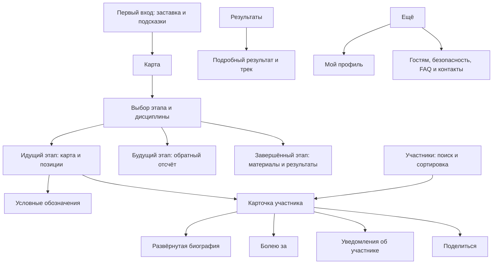

# Карта функций макета Авача

Срез на 1 ноября 2026 года. [Исходный макет](https://www.figma.com/design/dZcOxRfG88AY1tWW1s7HKH/?node-id=339-7522).

На странице «Для разработки» подробно оформлены карта, состояния этапа,
карточка участника и UI-kit. Остальные разделы присутствуют на странице
Wireframes с разной степенью детализации. Макет охватывает больше функций,
чем текущий бэкенд: кроме гонок и GPS, он предусматривает болельщиков,
подписки, историю КП, медиаматериалы и личный профиль.

Сопоставление выполнено с серверным кодом `main` на `f903f8f`, описанным
в [карте бэкенда](BACKEND_MAP.md). Наличие элемента в Figma означает наличие
дизайна или заготовки, а не работающего пользовательского сценария.

## Структура файла

| Страница | Содержимое и границы |
| --- | --- |
| Референсы и аналитика, `0:1` | Страница присутствует в файле; её исследовательские материалы в эту функциональную карту не включены |
| [Wireframes, `1:2`](https://www.figma.com/design/dZcOxRfG88AY1tWW1s7HKH/?node-id=1-2) | Онбординг, главные экраны, участники, результаты, результат участника, профиль, «Ещё», заготовки гостевой информации, безопасности и FAQ; есть повторы и устаревшие варианты |
| [Для разработки, `339:7522`](https://www.figma.com/design/dZcOxRfG88AY1tWW1s7HKH/?node-id=339-7522) | Два верхнеуровневых раздела: «Экран_карта» и «UI kit» |

В «Экран_карта» есть отдельно названные группы
[«Главный экран с легендой»](https://www.figma.com/design/dZcOxRfG88AY1tWW1s7HKH/?node-id=462-10123)
и [«Экран участника (обновленный)»](https://www.figma.com/design/dZcOxRfG88AY1tWW1s7HKH/?node-id=462-11182).
Их следует учитывать при реализации вместе с прежними экранами в том же разделе.
На Wireframes явно сохранён «экран участника (устаревшая версия)»;
он не должен автоматически становиться основным образцом.

## Навигация и пользовательские сценарии

В нижней панели пять разделов: **Карта, Участники, Результаты, Программа, Ещё**.
Профиль открывается из «Ещё». В шапке — название гонки и выбор этапа.
Для карты, участников и результатов предусмотрены фильтр дисциплины и «Мои».

Это карта видимых переходов и действий. Подробные правила авторизации,
доставки уведомлений и хранения избранного самим рисунком не определены.

## Что есть на странице Для разработки

### Живая карта

Источник: [раздел карты, `339:7523`](https://www.figma.com/design/dZcOxRfG88AY1tWW1s7HKH/?node-id=339-7523).

| Элемент | Что показано |
| --- | --- |
| Шапка | Гонка «Авача 2027», селектор этапа с номером, датой и состоянием |
| Фильтры | Все дисциплины или конкретная дисциплина; вкладка «Мои» |
| Карта | Географическая подложка, линия маршрута, участники со стартовыми номерами, КП, старт и финиш |
| Варианты маркеров | Обычный участник, мой участник, лидер, расчётный вариант, устаревшая позиция |
| Группировка | Обозначение дополнительных участников на маршруте, например «+4» |
| Лидеры | Компактный блок лидеров по дисциплинам; в спецификации также вариант списка внутри выбранной дисциплины |
| Управление | Увеличение и уменьшение масштаба; кнопка информации о карте |
| Свежесть | Метка времени положения и варианты состояния данных |
| Легенда | Шторка «Условные обозначения», объясняющая различия маркеров |

В [группе с легендой](https://www.figma.com/design/dZcOxRfG88AY1tWW1s7HKH/?node-id=462-10123)
показаны закрытое состояние и раскрытая шторка. В ней отдельно объясняются
мой участник, лидер, расчётный вариант, устаревшая позиция, другие участники
и дополнительные участники на маршруте.

### Карточка участника

Источник: [обновлённая группа, `462:11182`](https://www.figma.com/design/dZcOxRfG88AY1tWW1s7HKH/?node-id=462-11182),
[компактная карточка, `462:10977`](https://www.figma.com/design/dZcOxRfG88AY1tWW1s7HKH/?node-id=462-10977).

Предусмотрены компактная шторка и развёрнутая версия с биографией.
В обновлённом варианте видны следующие данные и действия:

- Стартовый номер и дисциплина в верхних метках.
- Фотография, имя, регион, подпись о собаках и их числе.
- Раскрытие биографии и возврат к компактному виду.
- Число болельщиков и прирост за сутки, например «1240 болельщиков, +87 за сутки».
- Место и время подтверждённого положения.
- Отставание от лидера, скорость и пройденная дистанция.
- История участков между КП: название, километраж, дата, время и статус «Проходит» или «Пройден».
- Кнопки **«Болею за»**, **поделиться** и отдельная кнопка **уведомлений**.
- Закрытие шторки; на прежней схеме переходов также обозначены смахивание вниз и нажатие вне шторки.

Значения имени, биографии, времени, счётчиков и дистанции являются примерами
наполнения. Они не подтверждают реальные сведения об участниках гонки.

### Предложение включить уведомления

Источник: [экран с попапом, `339:7592`](https://www.figma.com/design/dZcOxRfG88AY1tWW1s7HKH/?node-id=339-7592).

На схеме после «Болею за» показано модальное предложение получать уведомления
об участнике с действиями «Позже» и «Да, разрешить». Закрытие возвращает на карту.
Поддержка участника и разрешение уведомлений представлены отдельными действиями;
их нельзя считать одним и тем же пользовательским согласием.

### Выбор этапа и состояния до старта и после финиша

| Состояние | Что есть в макете | Источник |
| --- | --- | --- |
| Этап идёт | Карта, фильтры, участники, лидеры и время положения | [Главная карта](https://www.figma.com/design/dZcOxRfG88AY1tWW1s7HKH/?node-id=339-7524) |
| Открыт выбор этапа | Список этапов с датами и состояниями | [Селектор](https://www.figma.com/design/dZcOxRfG88AY1tWW1s7HKH/?node-id=339-7589) |
| Этап завершён | Обложка, сообщение о завершении, время старта/финиша, кнопка результатов, текст, материалы старта и финиша, фото и маршрут | [Экран завершённого этапа](https://www.figma.com/design/dZcOxRfG88AY1tWW1s7HKH/?node-id=352-7421) |
| Этап ещё не начался | Обложка, дата, обратный отсчёт и возврат к идущему этапу | [Экран до старта](https://www.figma.com/design/dZcOxRfG88AY1tWW1s7HKH/?node-id=339-7837) |
| Галерея | Крупная фотография, миниатюры, счётчик дополнительных фотографий и раскрытый список | [Галерея](https://www.figma.com/design/dZcOxRfG88AY1tWW1s7HKH/?node-id=352-7610) |

В спецификации элементов перечислены пять состояний метки данных:
`live`, `confirmed`, `stale`, `no connection`, `no data`.
Потеря сети и устаревшая GPS-точка — разные состояния: одно не доказывает другое.
Отдельный детальный экран отменённого этапа в рассмотренной группе не обнаружен.

### UI kit

Источник: [UI kit, `339:7869`](https://www.figma.com/design/dZcOxRfG88AY1tWW1s7HKH/?node-id=339-7869).
В разделе 83 непосредственных элемента: это смесь компонентов, наборов вариантов,
примеров, пояснений и групп, а не 83 самостоятельных экрана.

| Группа | Примеры присутствующих элементов |
| --- | --- |
| Навигация | Нижняя панель и её активные/неактивные пункты, Panel Header |
| Выбор и фильтрация | Select, меню этапов, строки выбора, Tabs и dropdown дисциплин |
| Данные гонки | Time badge с пятью состояниями, карточки лидеров, позиция участника, отставание и статистика |
| Участник | Banner, детали участника, номер/место, поддержка и модальное предложение уведомлений |
| Карта | Маркеры с вариантами, КП, старт, финиш, зрительская точка, легенда, кнопки информации |
| Маршрут | Строка route point и связанные обозначения |
| Контент | Карточка события, варианты даты, чипы |
| Общие элементы | Кнопки и группы кнопок, иконки, состояния уведомлений |

## Что дополнительно есть на Wireframes

Эти экраны находятся вне двух разделов страницы «Для разработки».
Степень их детализации различается; перечисление ниже не делает их утверждённой спецификацией.

| Раздел | Подтверждённое содержимое | Источник |
| --- | --- | --- |
| Онбординг | Заставка и последовательность подсказок поверх карты, фильтров, маркера и разделов нижней навигации; есть «Пропустить» | [Онбординг](https://www.figma.com/design/dZcOxRfG88AY1tWW1s7HKH/?node-id=326-8590) |
| Участники | Поиск по имени, фильтр дисциплины, «Мои», список участников с номером, дисциплиной и болельщиками; меню сортировки по номеру, текущему месту и числу болельщиков | [Участники](https://www.figma.com/design/dZcOxRfG88AY1tWW1s7HKH/?node-id=429-7473) |
| Результаты | Выбор этапа, дисциплина, «Мои», строки с местом, участником и временем; в группе есть варианты вкладок | [Группа результатов](https://www.figma.com/design/dZcOxRfG88AY1tWW1s7HKH/?node-id=462-10923), [результаты зрителя](https://www.figma.com/design/dZcOxRfG88AY1tWW1s7HKH/?node-id=490-11356) |
| Подробный результат | Участник, место, дата и время финиша, итоговое время, отставание, дистанция, КП, «Трек на карте» и поделиться | [Результат участника](https://www.figma.com/design/dZcOxRfG88AY1tWW1s7HKH/?node-id=491-15466) |
| Дополнительные данные результата | Отдельные раскрываемые блоки прохождения КП, обязательных остановок и штрафов с временем и причиной | [Информация](https://www.figma.com/design/dZcOxRfG88AY1tWW1s7HKH/?node-id=491-17271) |
| Ещё | Вход в «Мой профиль», разделы «Гостям», «Техника безопасности», «FAQ и контакты» | [Ещё](https://www.figma.com/design/dZcOxRfG88AY1tWW1s7HKH/?node-id=490-10305), [подробный вариант](https://www.figma.com/design/dZcOxRfG88AY1tWW1s7HKH/?node-id=491-17512) |
| Профиль | Имя, роль «Болельщик», подпись входа через ВКонтакте, список «За кого болею»; заголовки Push-уведомлений и сохранённых материалов | [Профиль](https://www.figma.com/design/dZcOxRfG88AY1tWW1s7HKH/?node-id=491-16682) |
| Гостевая информация | Слои «гостям», «тб», `faq`, иконки и варианты свёрнутых/раскрытых блоков | [Гостям](https://www.figma.com/design/dZcOxRfG88AY1tWW1s7HKH/?node-id=491-11623), [FAQ](https://www.figma.com/design/dZcOxRfG88AY1tWW1s7HKH/?node-id=491-11684) |

«Программа» присутствует в навигации и примерах элементов UI-kit.
Рядом с экранами «Ещё» видна карточка локации с событиями на день,
описанием, кнопкой маршрута в Яндекс Картах и уведомлением.
Полный состав программы и все её переходы в этом срезе не инвентаризированы.
Заголовки «Push-уведомления» и «Сохранённые материалы» в профиле обозначают
намерение функции, но сами по себе не описывают её состояния и правила.

## Покрытие макета текущим бэкендом

«Есть API» означает наличие данных и HTTP-маршрута на сервере.
Это не оценка готовности frontend или наполнения реальной базы.

| Функция макета | Покрытие | Что использовать или добавить |
| --- | --- | --- |
| Гонка, этапы и дисциплины | Есть API | `/api/races/current`, `/api/races/{id}`, `/api/races/{id}/stages` |
| Состояние этапа и обратный отсчёт | Есть базовые данные | `status`, `start_at`, `finish_at`; отсчёт рисует клиент |
| Геометрия маршрута и расположение КП | Есть API | `/api/stages/{stage_id}`: GeoJSON, КП, километраж, профиль высот |
| Подтверждённые позиции и устаревание | Есть API | `/api/races/{id}/positions`: `position`, `position_at`, `is_stale` |
| Скорость, дистанция и GPS-позиция | Есть API | `avg_speed_kmh`, `km_on_route`, `gps_rank`, `gap_to_leader_km`; величины могут быть `null` |
| Лидеры на карте | Можно собрать на клиенте | GPS-позиции уже разделены по дисциплинам; официальных лидеров брать из результатов |
| Легенда, масштаб, визуальная группировка маркеров | Работа клиента | Для обозначений отдельная серверная сущность не требуется; группировка зависит от масштаба карты |
| Поиск, дисциплина, сортировка по номеру/месту | Есть API | `/api/races/{id}/participants?q=...&discipline=...&sort=...` |
| Фото, имя, регион, биография, число собак | Частично есть API | Карточка спортсмена и участие в гонке; отдельного поля породы/типа собак, как «Ездовые лайки», нет |
| Официальные времена, штрафы, DNF/DNS | Есть API | `/api/races/{id}/results`, `/api/stages/{id}/protocols`; штрафы списком есть в строках зачёта |
| Трек участника | Есть API | `/api/race-participants/{id}/track?stage=N` |
| История прохождения КП и обязательных остановок | Только модели и часть настроек | `CheckpointPass` хранит приход/уход; у КП есть обязательный отдых. Нет публичной истории и API ручного ввода отметок |
| Личное точное время финиша | Нет нужного публичного поля | `StageResult` хранит длительность; `Stage.finish_at` относится к этапу, а не персональному финишу |
| Живое отставание в минутах | Нет GPS-показателя в таком виде | GPS API отдаёт километры, а временное отставание в результатах относится к официальному зачёту |
| Расчётный вариант маркера | Нет готового контракта | API отдаёт подтверждённую и предыдущую точки; расчётной позиции, времени оценки и признака оценки нет |
| «Болею за», число болельщиков, прирост за сутки | Нет | Нужны пользовательская идентичность, связи поддержки и правила подсчёта |
| «Мои» и сортировка по болельщикам | Нет серверного сценария | Поддерживаемые `sort`: `start_number`, `place`, `name`; значения по числу болельщиков нет |
| Подписка на участника и push | Нет | Нужны разрешение VK, сохранение предпочтений, события и доставка |
| Поделиться | Действие клиента с неописанным маршрутом | Нужны согласованные ссылки на участника/этап и открытие нужного состояния приложения |
| Фото и видеоматериалы этапа | Нет | Нет серверных моделей и API медиагалереи этапа |
| Программа и локации | Нет | Нужны события, даты, места и контент; указаны в плане бэкенда |
| Гостям, безопасность, FAQ, контакты | Нет контентного API | Тексты можно поставить статически либо добавить управление контентом — это отдельное решение |
| Профиль, избранное и сохранённые материалы | Нет | VK-пользователь, его настройки и сохранённые сущности пока отсутствуют |
| Онбординг | Преимущественно работа клиента | Для локального признака прохождения сервер не обязателен; синхронизация между устройствами требует профиля |

## Расхождения и решения перед реализацией

1. **Место на живой карте.** В карточке написано «2 место», рядом показано текущее
   положение. Сервер различает официальное `place` и `gps_rank`.
   Для GPS требуется явная подпись «позиция по GPS-трекеру»; один показатель не подменяет другой.
2. **Отставание в минутах во время гонки.** Пример `+03:42` нельзя заполнять
   значением `gap_to_leader_km`. Нужно определить источник временной оценки
   либо показывать расстояние до лидера. Официальное отставание относится к другому потоку данных.
3. **Расчётное положение.** В легенде есть «Расчётное время», но название не определяет
   алгоритм интерполяции или прогноза. Нельзя изображать подтверждённую точку
   как рассчитанное текущее положение без отдельной модели и подписи.
4. **Результаты всех дисциплин.** В варианте для зрителя под фильтром «все»
   показан общий пронумерованный список разных дисциплин. По правилам бэкенда
   места присваиваются внутри дисциплины: нужно группировать строки или явно обозначать область места.
5. **Итоги этапа и накопительный зачёт.** Макет использует заголовок «Итоги этапа».
   В серверном `StageResult.place` хранится место в общем зачёте после этапа,
   а `/stages/{id}/protocols` возвращает накопительный зачёт с ячейками этапов.
   Если экран должен ранжировать по времени только одного этапа, это отдельная логика.
6. **Финиш участника.** Время финиша всего этапа нельзя выдавать за момент
   финиша конкретного спортсмена. Для подписи «Финиш 6 февраля, 16:07» нужен персональный источник.
7. **КП и обязательный отдых.** Географическая точка из `StageCheckpoint`
   не доказывает, что участник её прошёл или завершил обязательную остановку.
   Нужны реальные отметки и правила определения статусов участков.
8. **Момент штрафа.** В заготовке есть дата и время нарушения/штрафа.
   Публичный штраф сейчас содержит длительность, причину и пункт правил;
   время создания записи не следует автоматически трактовать как время нарушения.
9. **Скорость и дистанция.** Сервер считает среднюю скорость между точками и
   километр на трассе выбранного этапа. Подписи «скорость» и «пройдено»
   стоит уточнить, если дизайн подразумевает мгновенную скорость или сумму за всю гонку.
10. **Согласованность дат.** Даты этапов, прохождения КП и времени положения
    в примерах не образуют проверенный календарь одной гонки. Реальный интерфейс
    должен брать их из одного набора данных и переводить UTC в `Asia/Kamchatka`.

## Практический порядок реализации

Существующего API достаточно для первого сценария: выбрать гонку и этап,
посмотреть подтверждённые позиции, открыть данные участника, список участников,
официальные результаты и трек. Легенда, масштабирование, поиск и состояние
сети могут быть реализованы на клиенте поверх этих данных.

Следующий серверный блок — отметки КП и персональный финиш, если подробная
карточка должна соответствовать макету. Параллельно можно разработать
пользовательский контур: VK-идентичность → поддержка участников → «Мои»
и счётчики → подписки → доставка уведомлений. Медиагалерея, программа,
локации и справочный контент требуют отдельного наполнения и управления.

До появления данных макетные счётчики, биографии, фотографии, пройденные КП
и время финиша не должны становиться фиктивными ответами приложения.

## Границы проверки

Структура страницы «Для разработки», её разделы, основные фреймы и общий
снимок карты получены через Figma MCP. После достижения лимита Starter
обновлённая карточка и перечисленные группы Wireframes проверены в браузере.
Новые нативные документы Figma Specs для этого анализа не использовались:
раздел с названием «Спецификация» на холсте состоит из обычных визуальных элементов.

Полный аудит всех слоёв Wireframes, текстов аналитики, вариантов дизайн-токенов,
пиксельного соответствия коду и работающего интерактивного прототипа не проводился.
Сам макет и исходники приложения не изменялись; добавлен только этот документ.
