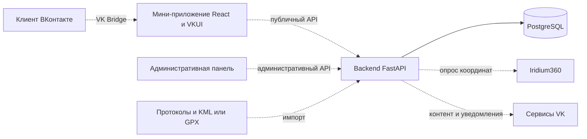

# Карта проекта Авача и план подготовки UI-kit

> Текущая поставка: [API и новый дизайн, 4 ноября](backend-design-update.md).
> Ниже сохранён предыдущий срез; новые редакторы контента и экраны описаны по ссылке.

> Актуальный срез на 3 ноября 2026: [завершение frontend и админки](frontend-admin-completion.md).
> Ниже сохранён исторический аудит. Его отметки о заготовках, моках и отсутствующих API
> не описывают ветку `codex/complete-frontend-admin`; функции этой ветки ещё не слиты в `main`.

## Экран карты: 17.10.2026

- Собран весь раздел Figma `339:7523`: карта, участник, поддержка, этапы и галерея.
- Существующие VKUI-композиции, локальные ассеты, 16 новых stories, без новых зависимостей.
- Backend не менялся; данные и поддержка демонстрационные.
- 106 тестов, 33 рабочих модуля, покрытие 100/100/100/100, обе сборки проходят.
- [Подробности и границы реализации](MAP_SCREEN.md).

## Разделение каталога и аудит Figma: 16.10.2026

- Две колонки Figma → отдельные компоненты и stories; 189 stories, 42 docs.
- Общая story удалена; смешанные примеры разделены, иконки представлены по одной.
- Подключение MCP работает, но достигнут лимит Starter. Шрифтов на компьютере нет.
- Исправлены авторские маркеры, статусы, КП, отставание, маршрут и Event card.
- 90 тестов, 29 рабочих модулей, 100/100/100/100. Полное визуальное совпадение не заявлено.
- [Таблица узел → код → story и проверенные размеры](UI_KIT_FIGMA_AUDIT.md).

Ниже — история предыдущих этапов; актуальный каталог описан выше.

## Перенос всего UI-kit: 16.10.2026

Пользователь разрешил перенести весь состав и поведение на стандартных токенах
VKUI, отложив шрифты и точную визуальную сверку. [Состав и проверки](UI_KIT_TRANSFER.md).

- Каталог: 107 stories, 27 страниц документации, общий раздел «Обзор / UI kit».
- Добавлены навигация, шапка с фильтрами, строки/меню, Banner, настройки
  уведомлений, лидеры, статусы времени, маркеры и маршрут, управление картой,
  карточка события, диалоги подписки и участника.
- Официальные VKUI 8.4.2 и иконки 3.76.0. Действия вновь используют стандартный
  accent; поддержка показывает иконку сердца. API/БД/реальные интеграции не менялись.
- 75 тестов, 26 рабочих модулей, каждый 100/100/100/100; lint, типы и обе сборки проходят.
- Обе темы, 360/390/768/1280 px, интерактивность проверены в браузере.
  Остались замечания по контрасту стандартных токенов; точная визуальная приёмка отложена.

## Базовый UI-kit: срез 15.10.2026

Подготовлен frontend на React 19, TypeScript, Vite 8 и VKUI 8, общий провайдер
светлой/тёмной темы и платформы, Storybook 10 с 41 story и документацией компонентов.
Выбор пользователя: **только базовые компоненты, стандартная тема VKUI, TDD и
100% покрытия собственного рабочего frontend-кода**.

- Готовы SupportButton, TextField, InfoCard, ParticipantCard, DataState и DataFreshness.
- Кнопки, поиск, селекторы и типографика используют стандартные компоненты VKUI.
- Витрина и Storybook работают на демонстрационных данных без backend и клиента VK.
- 34 теста покрывают 9 рабочих модулей, включая приложение и точку входа.
  Порог statements/branches/functions/lines — 100% для каждого файла.
- Светлая/тёмная тема, Android/iOS/VK Web и размеры 360/390/768/1280 доступны
  в каталоге. Для контраста используются штатные neutral-кнопки и основной
  цвет текста для мелких подписей; собственная брендовая палитра не вводилась.
- Исходные приблизительные токены перенесены в [справочный архив](brand/theme.reference.ts).

Запуск, props, stories и правила TDD: [frontend README](../frontend/README.md).
Результаты приёмки: [UI_KIT_VALIDATION.md](UI_KIT_VALIDATION.md).
Продуктовый и визуальный контекст: [PRODUCT.md](../PRODUCT.md), [DESIGN.md](../DESIGN.md).

**Следующий этап:** утверждённая брендизация, финальные экраны и связный первый
сценарий, навигация, карта, Bridge, авторизация, API, кэш, подписки и push.
Эти функции не считаются реализованными по наличию компонентов.
Backend и административная панель в этом этапе не менялись.

## Исходный аудит репозитория до реализации UI-kit

Разделы 1–8 ниже сохранены как исторический срез main от 15.10.2026 до начала
frontend-разработки. Их статусы и предварительный план раздела 7 **не заменяют
актуальный статус рабочей копии выше**. Первый сценарий и VK Bridge были
исключены пользователем из текущего этапа. Исходный аудит фиксировал серверный
каркас и модели данных, frontend и админ-панель тогда были заготовками.

## 1. Паспорт и источники

Продукт — VK Mini App гонки «Авача» в рамках зимнего фестиваля «Берингия» для Министерства туризма Камчатского края. Основные пользователи: онлайн-болельщики, зрители на Камчатке, туристы и участники. Организаторы работают через отдельную административную панель.

Репозиторий: [giuliajp/Kamchatka](https://github.com/giuliajp/Kamchatka). Проверены все три удалённые ветки; в локальной копии выбрана `main`.

| Ветка | Проверенный SHA | Состояние относительно main |
| --- | --- | --- |
| `main` | `26f183a0316be0ea55113f3e6141cef5241101b7` | Базовый срез; последний коммит от 12.10.2026 |
| `feature/parser-protocol` | `9dc75d62b8b6c4e3f62bccaba57de6d23d49f8c7` | На 15 коммитов впереди, не отстаёт; парсер ещё не включён в main |
| `chore/docker-compose-db` | `75c99087736330aee54cdb5cca1339d9d2a8bf4d` | Отстаёт на 2 коммита, уникальных коммитов относительно main нет |

Источники требований:

- `Бриф_VK_Mini_App.docx` — исходные цели, экраны, сценарии, технические требования. Передан отдельно, в `main` не хранится.
- `Ответы на вопросы по брифу.docx` — последующие уточнения; в пересекающихся требованиях используются вместо прежних формулировок. Передан отдельно, в `main` не хранится.
- `Total_result_Avacha-2026 (2).pdf` — предоставленный образец официального протокола и входной файл проверки парсера. В ветке парсера также есть свой PDF в `docs/`; проверка выполнена именно на пользовательском вложении.
- `_k_brand_p1_w3.pdf` — предоставленное руководство туристического бренда Камчатки, страницы 13–15 с цветами и шрифтом. В репозитории есть [брендбук](../design/brandbook/kamchatka-brandbook.pdf), [описание цветов](brand/colors.md) и [типографика](brand/typography.md).
- [Файл Figma и статус доступа](../design/figma-link.md) — ссылка предоставлена пользователем. Подключённый инструмент вернул отказ из-за недостаточных прав; экраны, варианты и токены Figma не проверены. Отказ инструмента не доказывает отсутствие макетов или невозможность просмотра в браузере.
- [План backend](backend-plan.md), [черновик API](api.md), [предметная область](domain.md), [БД](database.md), [перечень экранов](screens.md) — внутренняя документация, сверенная с исходниками.

Тексты вложений рассматриваются как требования и справочные материалы, а не как отдельное разрешение менять продукт, связываться с заказчиком или публиковать изменения. Статусы выполнения определяются по коду, а не по формулировкам брифа или отметкам в плане.

В брифе заявлена готовность в октябре 2026 года, в плане backend — 18 октября 2026 года. Это исходные сроки документов, а не подтверждённая оценка оставшейся работы.

## 2. Архитектура и навигация по репозиторию

Это целевая схема: пунктир обозначает ещё не реализованные связи. Для FastAPI и PostgreSQL есть код подключения и конфигурация; работа развёрнутого сервиса в этом аудите не проверялась. Frontend должен получать трекинг через собственный backend.

| Каталог | Назначение | Что сейчас внутри |
| --- | --- | --- |
| [frontend](../frontend/) | Пользовательское мини-приложение | README, package.json с заглушками, папки будущих экранов, `theme.ts` |
| [backend](../backend/) | API, данные и интеграции | FastAPI, модели, Alembic, тесты, заготовка Iridium360 |
| [admin-panel](../admin-panel/) | Интерфейс организаторов | README, package.json с заглушками, пустые папки компонентов и страниц |
| [docs](./) | Требования и технические договорённости | Обзоры брифа, экранов, бренда, backend, API и БД |
| [design](../design/) | Дизайн и ассеты | PDF брендбука, документация, папка ассетов с `.gitkeep` |
| [compose.yaml](../compose.yaml) | Локальная БД | PostgreSQL 17, volume и healthcheck; контейнеров frontend/backend нет |

## 3. Матрица готовности

**Реализовано** означает наличие содержательного кода, но не автоматически успешный запуск или готовность к выпуску. **Заготовка** — структура или код с пропущенной функциональностью. **Только описано** — требование без реализации в проверенных исходниках. **В отдельной ветке** — код не входит в `main`. **Не проверено** — нет достаточного доступа или проверки выполнения.

| Блок | Статус | Подтверждение | Что остаётся и от чего зависит |
| --- | --- | --- | --- |
| React, TypeScript и сборка frontend | Заготовка | [package.json](../frontend/package.json), [README](../frontend/README.md): нет зависимостей, dev/build/lint вызывают echo | Инициализировать Vite, точку входа, TypeScript и реальные команды |
| VKUI и VK Bridge | Только описано | [frontend README](../frontend/README.md); зависимостей и вызовов в коде нет | Установить и подключить библиотеку, провайдеры и обработку окружения VK |
| Storybook | Только планируется этим документом | В main нет конфигурации, stories и зависимостей | Настроить после сборки frontend; общий контекст с приложением |
| Цвета и типографика | Заготовка | [исходный theme.ts, архив](brand/theme.reference.ts): цвета, две темы, семейство и веса шрифта | Утвердить цифровые значения, размеры и состояния; подключить тему к компонентам |
| UI-kit | Только описано | [components](../frontend/src/components/) содержит только `.gitkeep` | Базовые компоненты и композиции первого сценария; зависит от стилей |
| Экраны и навигация | Заготовка | [screens](../frontend/src/screens/), [список экранов](screens.md) | Реализовать все экраны, нижнее меню, переходы и сохранение состояния |
| Каркас API | Реализовано | [main.py](../backend/app/main.py), [обработчики ошибок](../backend/app/middleware/errors.py), [общие схемы](../backend/app/schemas/common.py) | Подключить предметные маршруты; выполнить проверки запуска |
| Проверка сервиса и БД | Реализовано | [health.py](../backend/app/api/routes/health.py): GET /health, SELECT 1, ответы 200/503 | Проверить с работающей и недоступной БД; runtime в аудите не проверен |
| Модели и миграции | Реализовано | [models](../backend/app/models/), [две миграции](../backend/migrations/versions/), [Compose](../compose.yaml) | Проверить миграции на чистой БД; добавить модели ещё не охваченных функций |
| API гонок, участников, этапов и результатов | Только описано | [api.md](api.md); [main.py](../backend/app/main.py) подключает только health | Запросы, схемы ответов, фильтрация и тесты; зависит от данных и правил публикации |
| PDF → структурированные данные | В отдельной ветке | [parse_protocol.py в проверенном коммите](https://github.com/giuliajp/Kamchatka/blob/9dc75d62b8b6c4e3f62bccaba57de6d23d49f8c7/backend/scripts/parse_protocol.py) | Проверен образец 2026; нужны разбор предупреждений, тесты и ревью перед слиянием |
| Импорт в БД и публикация протоколов | Только описано | [план backend](backend-plan.md), [модели протоколов](../backend/app/models/protocol.py) | Импорт, проверка повторов, публикация, утверждение и журнал изменений |
| Iridium360 | Заготовка | В историческом срезе — клиент с NotImplementedError; при чистке 27.10.2026 заготовка удалена, [требования сохранены](iridium360.md) | API поставщика, ключ, список устройств, опрос, сохранение и повторные попытки |
| Хранение треков и SOS | Реализовано на уровне моделей | [tracking.py](../backend/app/models/tracking.py): устройства, назначения, позиции, отдельные тревоги | Приём точек, публичные схемы без SOS, закрытый мониторинг; модели сами не обеспечивают разделение доступа |
| Маршрут, KML/GPX и профиль высот | Заготовка данных | [stage.py](../backend/app/models/stage.py): маршрут и контрольные пункты | Парсинг файлов, профиль высот, замена маршрута во время гонки и интерфейс карты |
| Админ-панель и вход организаторов | Заготовка | [admin-panel](../admin-panel/), [план API](api.md) | Сборка, вход, права, редактирование гонки, контента, результатов и мониторинг |
| «Болею за», счётчики и рейтинг | Только описано | [бриф](brief-summary.md), [отложенные задачи](backend-plan.md) | Модель пользователей и подписок, API, динамика за сутки, интерфейс |
| Push, шеринг и избранное VK | Только описано | [бриф](brief-summary.md); нет кода интеграции | Регистрация приложения, разрешения, методы VK, обработка отказов |
| Новости, видео, фото и закладки | Только описано | [экраны](screens.md), [предметная область](domain.md) | Интеграция сообщества, медиаконтент, закладки, возврат с сохранением состояния |
| Программа, локации, FAQ и контакты | Только описано | [план API](api.md), [экраны](screens.md) | Модели, API, административное наполнение, экраны и кэш |
| Офлайн и свежесть данных | Только описано в UI | [frontend README](../frontend/README.md), настройки интервалов в [race.py](../backend/app/models/race.py) и [stage.py](../backend/app/models/stage.py) | Кэш, время обновления, устаревание, восстановление соединения, повтор запроса |
| Автоматические проверки | Реализованы тесты backend | [test_api_basics.py](../backend/tests/test_api_basics.py): 5; [test_models.py](../backend/tests/test_models.py): 16 | Выполнить 21 тест с PostgreSQL; frontend-тестов и CI в main нет |
| Деплой, нагрузка, аналитика и передача | Только описано | [бриф](brief-summary.md), [план backend](backend-plan.md) | Хостинг, наблюдаемость, нагрузочная проверка, метрики, инструкции и обучение |
| Финальные макеты Figma | Не проверено | [Ссылка и ограничение доступа](../design/figma-link.md) | Проверить экранные макеты, компоненты, обе темы и интерактивный прототип |

В 16 таблицах представлены гонки, дисциплины, участники, участие в сезоне, этапы, КП, КП этапов, отметки КП, протоколы, результаты этапов, штрафы, журнал правок, трекеры, назначения, позиции и тревоги. Модели пользователей админки, поддержки участников, программы и медиаконтента пока отсутствуют. Наличие таблиц результатов не означает готовность расчётов, импорта и публикации через API.

## 4. Проверка парсера и её границы

Функция `parse_protocol` из ветки `feature/parser-protocol` выполнена на предоставленном PDF без переключения ветки, записи в БД и сохранения выходного JSON. Внутренняя проверка структуры и суммы времени завершилась успешно.

| Показатель | Результат |
| --- | --- |
| Участники | 21: лыжи — 5, нарта 8 собак — 6, нарта более 8 собак — 10 |
| Этапы | 6 |
| Записи результатов этапов | 126; это не 126 успешных финишей |
| Распознанные штрафы | 3 |
| Предупреждения | 11 |

Восемь предупреждений относятся к нулевым значениям после схода/нестарта: №1, этапы 2–6; №10, этапы 4–6. Ещё три — к отсутствию номера этапа применения штрафа у №18, №19 и №12. Эти неоднозначности нужно разрешить до импорта; нулевое время не следует выдавать за результат завершённого этапа.

Парсер рассчитан на структуру PDF образца 2026 и известные названия трёх дисциплин. Это ограничение формата импорта, а не основание фиксировать дисциплины в пользовательском интерфейсе. Поддержка Excel, других шаблонов, фактического числа собак на старте/финише и запись в БД этой проверкой не подтверждены. Нельзя повторно прибавлять штраф к времени, если он уже включён в официальный результат; этап применения штрафа должен подтверждаться источником.

## 5. Уточнения требований и расхождения

| Тема | Актуальное правило | Последствие для реализации |
| --- | --- | --- |
| Этапы и сезон | Выбор сезон → этап; дата — информация об этапе, отдельного фильтра даты нет | Число этапов меняется; поддержать переход через полночь, 4 и 7 этапов |
| Дисциплины | Нет общего зачёта между дисциплинами; справочник управляется из админки | Сортировать места внутри дисциплины; не объединять несколько первых мест в один рейтинг |
| Лидеры на карте | Выбрана дисциплина — её топ-3; выбрано «Все» — один лидер каждой дисциплины с подписью | Компонент лидеров поддерживает оба режима; число дисциплин не фиксировать |
| Результаты | Одна вкладка «Протоколы»; официальный источник — итоговый судейский протокол | Отдельные вкладки штрафов и остановок из исходного брифа не требуются |
| DNF и DNS | Участника сохранять в протоколе, на следующих этапах располагать в конце, вместо результатов показывать «—» | Не удалять строку и не показывать нулевое время; сохранять уже пройденные этапы |
| Количество собак | Обязательны значения на старте и финише этапа; состав может уменьшаться | Поля есть в модели StageResult, но полноту данных нужно обеспечить импортом/вводом |
| Маршрут | KML, контрольные точки, описания и замена трека во время гонки через админку | Поддержать KML наряду с упомянутым ранее GPX; профиль высот брать из данных маршрута |
| GPS | Последняя подтверждённая точка со временем; скорость — средняя между двумя точками | Не имитировать непрерывное движение и не выводить «остановился»/«сошёл» по отсутствию точек |
| Официальные результаты | GPS не определяет официальное время и место; приоритет у судейского протокола | Разделить показатели трекинга и официальную позицию, включая источники подписей |
| SOS | Только административная часть | Не включать тревоги в публичные ответы, события и компоненты |
| Новости и шеринг | Карточка-анонс ведёт к исходному посту средствами клиента VK; репост исходной записи | Полный экран текста новости не нужен; сохранять прокрутку, выбранный этап и открытую карточку при возврате |
| Профиль | Закладки новостей и фото; кнопки выхода нет | Настройки push, отписка от всех участников, удаление из избранного и ссылка на управление разрешениями |
| Нет интернета | Последние данные и время обновления; при отсутствии кэша — сообщение и повтор | Кэшировать маршрут, программу, гостевой раздел, просмотренные карточки и область карты; обновлять после восстановления сети |

На карте по исходному брифу запрос к backend выполняется не реже одного раза в две минуты. Базовый интервал передачи трекера — 20 минут, он настраивается отдельно. В брифе одновременно указаны «более двух интервалов» и пример «более 45 минут»; это не одно арифметическое правило. В моделях уже выделен отдельный порог `stale_after_minutes`: конкретную политику устаревания нужно согласовать, а в UI получать готовое состояние и время точки. Потеря интернета у пользователя и устаревшая координата участника — разные состояния.

Выявленные расхождения, которые следует учитывать при продолжении работы:

- README перечисляет React/VKUI как стек, но в frontend нет зависимостей, точки входа и действующей сборки. Успех команды `build`, вызывающей `echo`, не является проверкой сборки.
- В документации типографики говорится о подключении шрифта через CSS-переменные, но `theme.ts` пока только экспортирует значения. Файлов шрифтов и интеграции темы нет.
- Текущие HEX обозначены как приблизительные; часть акцентных цветов визуально расходится с предоставленным PDF. Их нужно сверить с утверждённой цифровой палитрой. Брендбук Камчатки не определяет все UI-состояния «Авачи».
- Модель протокола содержит журнал правок и ограничения, но нет API публикации, авторизации и бизнес-операций. Эти функции нельзя отмечать готовыми по наличию моделей.
- Задача парсера уже продвинулась в отдельной ветке; статус проекта только по `main` недооценивает эту работу. Ветка Docker не добавляет функциональность сверх `main`.
- В backend-плане «Болею за», рейтинг, новости и push отложены за 18 октября. Полный первый сценарий брифа зависит от этих функций; UI-kit может показывать их на тестовых данных, но это не готовый пользовательский сценарий.

## 6. Очередь оставшихся работ по продукту

Порядок ниже отражает зависимости, а не новое календарное обязательство. Роли обозначают области работы; конкретных исполнителей назначает команда.

| Очередь | Направление | Результат и зависимости |
| --- | --- | --- |
| 1 | Дизайн и координация | Утвердить первый сценарий, цифровые стили, доступ к макетам и объём ближайшей сдачи; согласовать расхождения выше |
| 2 | Frontend | Подготовить сборку, VKUI, Storybook и UI-kit по разделу 7; можно работать на тестовых данных до готовности API |
| 2 | Backend и данные | Завершить ревью парсера, обработать предупреждения, добавить проверяемый импорт без дублей и загрузить архив 2026 |
| 3 | Backend | Реализовать гонки, участников, этапы, маршруты, протоколы и результаты; публичные ответы только для опубликованных данных |
| 3 | Административная часть | Вход и права, редактирование участников/этапов/КП, импорт и публикация протоколов, утверждение и журнал правок, замена KML/GPX |
| 4 | Трекинг | Интегрировать Iridium360, назначения устройств, историю, дедупликацию, ручные отметки КП, свежесть и среднюю скорость; SOS — только организаторам |
| 5 | Первый пользовательский сценарий | Собрать карту, мини-карточку и карточку участника; добавить поддержку, разрешения push и шеринг после появления соответствующих API и доступа VK |
| 6 | Остальные экраны и контент | Участники, протоколы и архив, маршрут, программа/локации, гости/FAQ/контакты, новости/видео/фото, профиль/закладки; административное наполнение |
| 7 | Устойчивость и выпуск | Кэш, восстановление состояния, мобильный/планшетный/web интерфейс, обе темы, проверки в клиентах VK, нагрузка, аналитика, деплой, инструкции и обучение |

Состав пользовательских экранов: приветствие, карта, карточка участника, участники, результаты, маршрут, программа, новости и трансляции, гостям, профиль. Нижняя навигация: Карта / Участники / Результаты / Программа / Ещё. Все десять папок экранов сейчас содержат только `.gitkeep`; раздел «Ещё» и навигационный каркас также предстоит собрать.

Нужные внешние материалы: исходные протоколы и правила работы со штрафами; KML/GPX с высотами и КП; фотографии/биографии; программа и гостевой контент; регистрация VK Mini App и доступ к сообществу; сервисный доступ Iridium360 и назначения устройств; инфраструктура размещения. Ключи передаются отдельно от репозитория. Требования к размещению в РФ, аналитике, нагрузке, передаче исходников, инструкции администратора, обучению и гарантийной поддержке остаются частью общего брифа.

## 7. Участок работ по VKUI, Storybook и UI-kit

### Граница результата

Обещанный результат — запускаемый frontend-каркас и каталог переиспользуемых компонентов с темами, состояниями и примерами. Готовые экраны можно будет собирать из этого набора после уточнения дизайна. Работа с реальной картой, трекерами, базой подписок и push-сервисом относится к последующей интеграции.

Предварительная основа — первый сценарий брифа: вход из сообщества → карта → метка участника → мини-карточка/карточка → «Болею за» → разрешение уведомлений → возврат на карту → шеринг. Состав ниже нужно сверить с дизайнером; он не выдан за инвентаризацию Figma.

### Последовательность подготовки

1. **Запускаемый каркас.** Инициализировать React + TypeScript + Vite в существующем frontend, сохранив структуру и токены. Добавить VKUI, иконки и VK Bridge; настроить общие провайдеры темы, адаптивности и корневого контекста. Заменить заглушки реальными командами dev/build/lint, добавить проверку типов и lockfile. Совместимые версии зафиксировать при реализации.
2. **Storybook.** Подключить к Vite, добавить команды `storybook` и `build-storybook`. Использовать те же стили и провайдеры, что в приложении; переключать светлую/тёмную тему и мобильный/планшетный/desktop размер. Вызовы Bridge заменить управляемыми сценариями, чтобы каталог работал без клиента VK, backend и секретов.
3. **Токены.** Разделить базовую палитру и семантические роли: фон, поверхность, основной/вторичный текст, акцент, граница, ошибка, успех и предупреждение. Добавить шкалу типографики, отступов и скруглений по согласованным стилям. Временные значения явно пометить; до получения шрифта использовать имеющийся системный fallback, не выдавая его за финальную типографику.
4. **Базовые компоненты.** Использовать возможности VKUI; проектные композиции добавлять там, где нужны брендовые параметры или предметное содержимое. Для каждого элемента документировать назначение, параметры и предусмотренные состояния.
5. **Первый сценарий.** Собрать компоненты карты и участника в демонстрационную композицию Storybook на тестовых данных, включая отказ в разрешении уведомлений, устаревшие координаты и повторное действие. Данные о результатах и координатах показывать раздельно.
6. **Передача.** Добавить инструкции запуска, правила использования токенов, таблицу соответствия дизайн → компонент → story и список временных решений. Проверить сборку приложения и каталога перед передачей дизайнеру и разработчикам экранов.

### Предварительный каталог

| Группа | Что включить | Обязательные примеры |
| --- | --- | --- |
| Цвета и типографика | Палитра, семантические роли, заголовки, текст, подписи, числовые показатели | Обе темы, кириллица, длинные имена, читаемость вторичного текста |
| Кнопки и действия | Основная, вторичная, иконка, «Болею за», «Поделиться», «Обновить» | Обычное, фокус, нажатие, недоступность, загрузка; поддерживаю/не поддерживаю |
| Поля и поиск | Текстовое поле, поиск по имени, подпись и сообщение ошибки | Пустое, заполненное, фокус, ошибка, недоступность, очистка |
| Выбор и фильтры | Сезон, этап, дисциплина с вариантом «Все» | Длинные названия, 4 и 7 этапов, динамический список дисциплин; дата внутри этапа |
| Карточки участника | Строка списка, мини-карточка, содержимое карточки | Фото/нет фото, имя, номер, регион, дисциплина, собаки, поддержка и суточная динамика |
| Показатели гонки | Лидеры, позиция, время точки, средняя скорость, статус | Топ-3 одной дисциплины / лидеры всех; отсутствующие значения и источник показателя |
| Элементы карты | Метка с номером, выделение поддерживаемого участника, содержимое нижней шторки | Выбрано/не выбрано, актуальная/устаревшая точка; демонстрация без картографического API |
| Уведомления и состояния | Баннер, сообщение, загрузка, пустые данные, ошибка и повтор | Нет интернета с кэшем/без кэша, устаревшие данные при доступной сети, push разрешены/отклонены |
| Режим гонки | Информационные блоки до старта и после финиша | До гонки, идёт гонка, гонка завершена; без фиктивного live-движения |

### Будущие зависимости от API

Названия маршрутов ниже взяты из [черновика API](api.md); они ещё не реализованы и не считаются окончательным контрактом. Текущий этап не меняет публичные API, типы и схемы БД.

| Компоненты | Какие данные нужны | Планируемый источник |
| --- | --- | --- |
| Сезон, этап и дисциплина | Идентификаторы, подписи, даты, статусы и справочник дисциплин | `/api/races`, `/api/races/current`, `/api/races/{id}/stages`; форму справочника согласовать |
| Список и карточка участника | Имя, фото, регион, номер, дисциплина и число собак по этапу | `/api/races/{id}/participants`, `/api/participants/{id}`; наполнение по этапам согласовать |
| Координата и время | Подтверждённая точка, время, свежесть, средняя скорость | `/api/races/{id}/positions`; без публичных данных SOS |
| Официальные лидеры и результаты | Опубликованные результаты по дисциплинам, статус, итог и штрафы | `/api/races/{id}/results`, `/api/stages/{id}/protocols`; не вычислять место из GPS |
| «Болею за» и разрешения | Подписка, число болельщиков, динамика, настройки уведомлений | Контракт поддержки пока отсутствует; разрешение клиента и серверная подписка — разные действия |
| Шеринг | Ссылка на конкретного участника и состояние операции | Формат ссылки/навигации и доступные методы VK согласовать при интеграции |

### Что требуется от дизайнера

- Утверждённые RGB/HEX для обеих тем и роли цветов в интерфейсе; связь брендов Камчатка, Берингия и Авача.
- Шрифтовые файлы с правом использования в web либо согласованный вариант замены; размеры, веса и межстрочные интервалы.
- Компоненты первого сценария, варианты и интерактивные состояния, отступы и скругления, мобильный и широкий вариант.
- Логотип «Авача», иконки, иллюстрации, изображения-заглушки и правила их использования.
- Доступный рабочий Figma-файл, ссылки на конкретные фреймы/компоненты и прототип первого сценария.

До получения этих материалов можно подготовить сборку, Storybook, структуру токенов и демонстрации состояний. Финальный внешний вид и соответствие Figma остаются отдельной проверкой.

### Критерии готовности будущего UI-kit

- Чистая установка по lockfile, запуск приложения и Storybook; действующие сборка, проверка типов и lint проходят.
- Каждая согласованная группа каталога имеет stories, обе темы и применимые состояния: loading, disabled, error, empty, stale и offline.
- Компоненты управляются входными данными и обработчиками; нет жёстко заданных дисциплин, числа этапов, запросов к Iridium360 или реальной отправки push из stories.
- Проверены длинные русские тексты, увеличение текста, мобильная ширина, клавиатурный фокус, доступные подписи и контраст.
- Демонстрация первого сценария работает на тестовых данных и явно отделена от реальной интеграции.
- Дизайнер проверил утверждённые стили; все оставшиеся временные решения перечислены в документации.

## 8. Проверки среза и дальнейшее обновление карты

В этом аудите проверены структура `main`, подключение маршрутов, зависимости и заглушки, модели, миграции, количество тестов и отличия двух дополнительных веток. Парсер повторно проверен на пользовательском PDF с результатом из раздела 4.

Backend-тесты не запускались: они требуют настроенной PostgreSQL и создают временные схемы через [conftest.py](../backend/tests/conftest.py). Для документационного этапа окружение приложения не разворачивалось. Frontend не собирался: действующей сборки нет. Визуальное соответствие Figma не проверено из-за отказа инструмента в доступе.

Следующие проверки по мере появления реализации:

- Backend: миграции с нуля, существующие 21 тест, импорт с повторной загрузкой, DNF/DNS, штрафы, разделение дисциплин и публикация только разрешённых протоколов.
- Трекинг: дубли, запоздавшие точки, смена трекера, конфигурируемые интервалы, отсутствие координат, ручная отметка КП и отсутствие SOS в публичных ответах.
- UI: обе темы, 4/7 этапов, произвольный список дисциплин, два режима лидеров, длинные имена и недоступные данные.
- Сценарии VK: отказ в push, повторное нажатие «Болею за», ссылка на участника, репост исходной новости и возврат без потери состояния.
- Устойчивость: первый вход без сети, работа с кэшем, восстановление соединения, замена маршрута во время гонки; перед выпуском — клиентские и нагрузочные проверки.

При обновлении карты менять дату и SHA, добавлять ссылки на реализацию и результаты проверок. После слияния ветки переводить её функции в `main` только по фактическому состоянию кода. Наличие папки, модели, макета или успешного `echo` не является доказательством готовности пользовательской функции.
