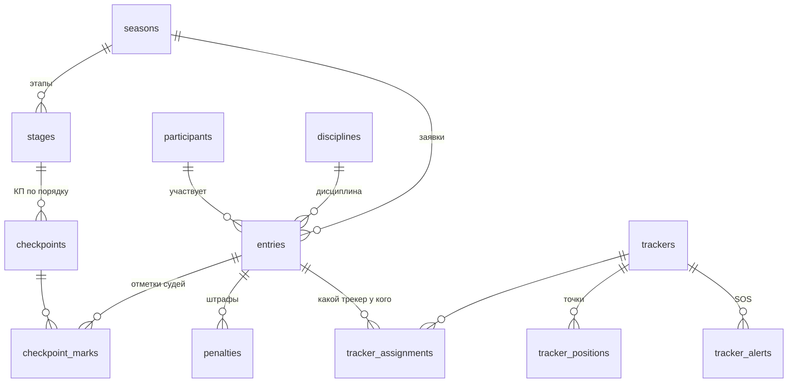

# Структура базы данных

Модели лежат в `backend/app/models/` (SQLAlchemy 2.0, асинхронно; базовый класс — `Base` из `app/db.py`).
Миграции — Alembic (`backend/migrations/`). Все даты и время хранятся в **UTC**
(Камчатка = UTC+12, переводим только при показе).

Локально и на сервере используется PostgreSQL (`asyncpg`) запускается через Docker Compose.
Связанные данные загружаются явно через `selectinload` — ленивая загрузка запрещена (`lazy="raise_on_sql"`).

## Схема

## Таблицы

| Таблица | Что хранит | Файл |
|---|---|---|
| `seasons` | Гонка одного года, режим «до / идёт / завершена», интервал трекинга (20 мин) и порог неактуальности (45 мин) | `season.py` |
| `disciplines` | Дисциплины для фильтров | `participant.py` |
| `participants` | Каюр как человек: имя, регион, био, фото | `participant.py` |
| `entries` | Участие каюра в сезоне: номер, дисциплина, собаки, статус | `participant.py` |
| `stages` | Этапы; могут переопределить интервал трекинга | `stage.py` |
| `checkpoints` | КП: порядок, координаты, высота, километраж, обязательная остановка | `stage.py` |
| `checkpoint_marks` | Отметки судей — **единственный источник официального времени** | `results.py` |
| `penalties` | Штрафы в минутах | `results.py` |
| `trackers` | Устройства Iridium по IMEI | `tracking.py` |
| `tracker_assignments` | Связь «IMEI → участник → этап» | `tracking.py` |
| `tracker_positions` | Подтверждённые точки. Дубликаты отклоняются | `tracking.py` |
| `tracker_alerts` | SOS. **Только для админки, в публичное API не отдавать** | `tracking.py` |

## Правила из брифа, заложенные в структуру

- Каюр (`Participant`) и его участие в сезоне (`Entry`) — разные таблицы. Это даёт архив прошлых лет. Отметки, штрафы, трекеры и «Болею за» привязываются к `Entry`.
- Стартовый номер уникален в пределах сезона.
- Расчётное (интерполированное) положение в базе **не хранится**, считается при запросе.
- Позиция неактуальна, если последняя точка старше `stale_after_minutes`.
- Скорость считается как средняя между двумя точками — поля «скорость» в позициях нет.

## Что добавим позже

Администраторы, подписки «Болею за», новости, программа, локации, FAQ.
