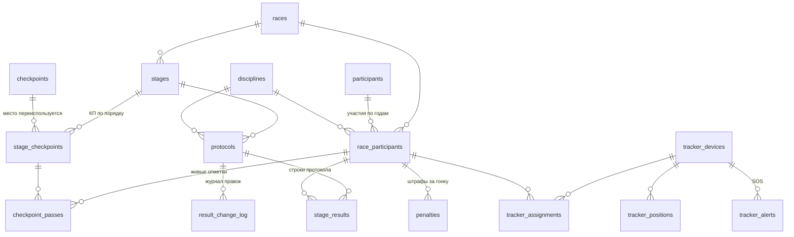

# Предметная область «Авача»

Главное описание данных проекта. Код моделей — `backend/app/models/`, по одному файлу на тему.
Основа — модель, предложенная командой, дополненная требованиями брифа и ответами куратора.

## Главные правила

1. **Официальные результаты — только из судейского протокола.** GPS и отметки на КП
   для результатов не используются. При расхождении GPS и судей приоритет у судей.
2. **Протокол публикуется после каждого этапа**, отдельно по каждой дисциплине.
   Бывает предварительным и окончательным.
3. **Предварительный протокол можно править, но каждая правка — в журнал.**
   Окончательный правится только особой процедурой: с основанием, указанием, кто утвердил,
   и видимой пометкой для пользователей.
4. **Штрафы относятся к участию в гонке (`RaceParticipant`).** Каждый штраф храним
   в `Penalty`, общую сумму вычисляем за гонку и показываем отдельно.
   Время этапов сохраняем как в протоколе: в исходном протоколе 2026 года оно уже включает штрафы.
5. **Итог финишировавшего участника = сумма итоговых времён этапов.** Штрафы повторно
   не прибавляем. Места — только внутри дисциплины, общего зачёта между дисциплинами нет.
6. **DNF / DNS не удаляются из протокола.** На следующих этапах участник остаётся
   в конце списка, вместо результатов — «—».
7. **Количество этапов, дисциплин, КП не фиксировано** — всё задаётся данными через админку.
8. **Время — UTC** (Камчатка = UTC+12). **Длительности — целые секунды.**
9. **SOS виден только в админке.**

## Схема

---

## Гонка и участники — `race.py`

### Race — гонка
Одно проведение: «Берингия. Авача 2027». Несколько гонок = архив прошлых лет.

| Поле | Описание |
|---|---|
| name, year | «Берингия. Авача 2027», 2027 (год уникален) |
| status | `upcoming` / `live` / `finished` — от него зависят экраны приложения |
| is_current | какую гонку показывать по умолчанию |
| start_date, end_date, location | даты и место |
| tracking_interval_minutes | интервал передачи точек трекером, по умолчанию 20 |
| stale_after_minutes | порог «данные устарели», по умолчанию 45 (> 2 интервалов) |

### Discipline — дисциплина
Справочник, редактируется в админке. Начальные данные — миграция `0002`:

| code | Название | Снаряжение | Собак |
|---|---|---|---|
| `ski_2` | Лыжи — длинная дистанция, 2 собаки | лыжи | 2 |
| `sled_8` | Нарта — длинная дистанция, 8 собак | нарта | 8 |
| `sled_8plus` | Нарта — длинная дистанция, более 8 собак | нарта | 9 и больше |

### Participant — спортсмен
Человек, одна запись на все годы: фамилия, имя, отчество, **год рождения**, фото, биография.
Год рождения нужен, чтобы при [импорте протоколов](protocol-import.md) разных лет узнавать того же человека
(ФИО + год рождения), а не создавать дубль.

### RaceParticipant — участие в гонке
Связь человека с гонкой. Всё, что относится к гонке (результаты, штрафы, трекер, отметки),
ссылается сюда.

| Поле | Описание |
|---|---|
| start_number | стартовый номер, уникален в гонке |
| discipline_id | дисциплина |
| region | регион, как указан в протоколе этого года |
| dogs_count | заявленное число собак (фактическое по этапам — в StageResult) |
| status | `registered` / `active` / `finished` / `dnf` / `dsq` / `out_of_competition` |

Статусы: `registered` — заявлен, не стартовал; `active` — продолжает; `finished` — завершил;
`dnf` — сошёл, пройденные этапы сохраняются, в текущем общем зачёте не участвует;
`dsq` — дисквалифицирован; `out_of_competition` — идёт маршрут вне зачёта.

Связь `penalties` содержит штрафы участника за эту гонку. Их общая сумма вычисляется
по записям `Penalty`, отдельной колонки с суммой нет.

---

## Маршрут — `stage.py`

### Stage — этап
Номер, название, длина (км), плановые старт и финиш (этап может закончиться после полуночи),
статус (`planned` / `live` / `finished` / `cancelled`).

Трек этапа (`route_geojson`) загружается из KML/GPX через админку и **может заменяться
во время гонки** (погода, ЧС). Высоты берутся из трека — из них строится профиль высот.

`tracking_interval_minutes`, `stale_after_minutes` — если пусто, берутся из гонки.

### Checkpoint — физическое место
Пиначево, Семёновский кордон, Центральный кордон, Биатлонный комплекс.
Название, координаты, высота. **Одно место используется на разных этапах и в разные годы.**

### StageCheckpoint — КП на этапе
Роль места на конкретном этапе: порядок, тип (`start` / `checkpoint` / `finish`),
подпись («КП-3»), км от старта, обязательная остановка (мин), описание участка до КП.
Старт и финиш этапа — первая и последняя запись. Одно место может встретиться на этапе
дважды (старт и финиш в одной точке).

### CheckpointPass — отметка на КП
Время прибытия и ухода (`departed_at` — для обязательных остановок), кто внёс.
**Только для живой трансляции и карты** («последняя подтверждённая точка»).
Официальные результаты отсюда не считаются.

---

## Официальные результаты — `protocol.py`

### Protocol — протокол этапа по дисциплине
Один протокол = один этап × одна дисциплина (результаты публикуются по дисциплинам).

| Поле | Описание |
|---|---|
| status | `preliminary` / `final` |
| published_at | пусто → черновик, в приложении не виден |
| finalized_at, finalized_by | когда и кто утвердил окончательный |
| weather, chief_judge, chief_secretary | шапка и подвал протокола |
| source_filename | из какого файла импортирован |

### StageResult — строка протокола

| Поле | Описание |
|---|---|
| status | `finished` / `dnf` / `dns` / `dsq` |
| net_time_seconds | необязательное время без штрафа; `null`, если источник его не содержит |
| final_time_seconds | итоговое время этапа, как в протоколе |
| dogs_at_start, dogs_at_finish | собаки на старте и финише этапа (могут уменьшаться) |
| place | место в зачёте дисциплины после этапа, как в протоколе (пусто — вычисляется) |
| note | «Примечания» из протокола |
| is_corrected_after_final | видимая пометка: исправлено после утверждения |

Проверки в базе: итоговое время обязательно у `finished` и отсутствует у `dnf` / `dns` / `dsq`;
чистое время, если задано, неотрицательно; собак на финише не больше, чем на старте.
Штрафы хранятся отдельно у участника гонки; в `StageResult` нет суммы штрафов
и проверки «итог = чистое + штраф».

[Парсер протокола 2026 года](protocol-parser.md) сохраняет итоговое время из источника и не вычисляет чистое время.

Скорость не храним — вычисляется: длина этапа / итоговое время.
Общий результат финишировавшего участника вычисляется как сумма `final_time_seconds`
по этапам, без повторного прибавления штрафов. Средняя скорость гонки — тоже вычисляется.

### Penalty — штраф участника за гонку

| Поле | Описание |
|---|---|
| race_participant_id | участие в гонке, которому назначен штраф (`RaceParticipant`) |
| seconds | длительность штрафа в секундах, строго больше нуля |
| reason | причина, необязательное поле |
| rule_reference | пункт правил, необязательное поле |

Пример из 2026: «штр. вр. 2 мин. п. П.14.11.14» →
`seconds=120`, `rule_reference="П.14.11.14"`.
Связь с этапом отсутствует. Общая сумма — `SUM(penalties.seconds)` для одного
`race_participant_id`; при отсутствии штрафов — 0. Штрафы показываются отдельно
от результатов этапов и повторно к итоговому времени не прибавляются.

### ResultChangeLog — журнал правок
Записи только добавляются. Что меняли (`entity`: результат / штраф / протокол),
действие, поле, старое и новое значение, кто, когда, причина.
`is_post_final=True` — правка окончательного протокола: **обязательны** основание (`reason`)
и утвердивший (`approved_by`) — проверяется в базе.

---

## Трекинг — `tracking.py`

| Таблица | Описание |
|---|---|
| TrackerDevice | устройство по IMEI, переиспользуется из года в год |
| TrackerAssignment | трекер → участник гонки, с какого по какое время, этап (необязательно). Трекер могут заменить посреди гонки |
| TrackerPosition | подтверждённая точка: время на устройстве и время получения, координаты, высота, курс, скорость устройства, заряд. `race_participant_id` фиксируется при получении. Дубли отклоняются по id точки Iridium и по времени |
| TrackerAlert | SOS: время, координаты, кто из организаторов увидел и когда. Только админка |

Положение на карте — всегда последняя подтверждённая точка с подписью времени.
Расчётное положение не хранится, вычисляется при запросе. Скорость для пользователя —
средняя между двумя точками (скорость устройства публично не показываем).

---

## Контент — `content.py`

Программа фестиваля, FAQ и зрительские локации общие для приложения,
без привязки к конкретной гонке. Таблицы создаёт миграция `0004`.

| Модель | Данные |
|---|---|
| SpectatorLocation | название, координаты; необязательные описание, адрес и описание проезда |
| ProgramEvent | название, время начала в UTC; необязательные описание, время окончания и локация |
| FaqItem | вопрос и ответ |

Одна локация может использоваться несколькими событиями. При удалении локации
события сохраняются, `location_id` становится `null`.

Все модели содержат порядок отображения `sort_order` (по умолчанию 0), признак
публикации `is_published` (по умолчанию `false`), даты создания и изменения.
Публичный API выдаёт опубликованные записи; неопубликованная локация в событии
возвращается как `location: null`.

Проверки базы: широта от −90 до 90, долгота от −180 до 180,
`sort_order >= 0`, время окончания события не раньше начала, если оно задано.
Адреса и примеры ответов — в [API](api.md), загрузка примеров —
в [README backend](../backend/README.md#примеры-контента).

---

## Админка и болельщики — `admin.py`, `support.py`, `stage.py`

Таблицы создаёт миграция `0005`.

| Модель | Данные |
|---|---|
| AdminUser | организатор: логин, имя (пишется в журналы), хеш пароля (scrypt), включён ли |
| CheckpointPassLog | журнал правок отметок КП: действие, было, стало, кто, когда. Остаётся после удаления отметки |
| SupportSubscription | «Болею за»: id пользователя VK, участник гонки, push вкл/выкл, дата подписки и отписки |

Отписка не удаляет строку, а ставит `cancelled_at`: так считается «+N за сутки» и динамика
по дням. Активная подписка у пары «пользователь — участник» одна (частичный уникальный индекс).

---

## Пользователи приложения, закладки, push — `app_user.py`

Таблицы создаёт миграция `0007`. Она же делает `ResultChangeLog.protocol_id` необязательным:
правки штрафов (штраф относится к гонке) пишутся в журнал без протокола.

| Модель | Данные |
|---|---|
| AppUser | id пользователя VK, разрешил ли уведомления, первый и последний запуск |
| Bookmark | «Сохранённые материалы»: новость или фото VK (id, заголовок, ссылка, картинка) |
| PushMessage | журнал рассылок: кому, текст, повод, получателей, доставлено, ошибка, кто отправил |
| EventReminder | колокольчик у события программы: пользователь VK, событие, когда отправлено (миграция 0008) |

Миграция `0008` добавляет: `image_urls` у событий и локаций, `dog_breed` у заявки,
`vk_user_id` у спортсмена (уникальный), `protocol_pdf_url` у гонки; типы событий
`master_class`, `meeting` и тип места `checkpoint`.

---

## Открытые вопросы

- Будут ли судьи вносить отметки на промежуточных КП во время этапа и где фиксируются
  обязательные остановки.
- Какие данные Iridium присылает для SOS — уточним при разборе API (задача 1.4).
- За какие годы нужен архив и есть ли исходные Excel-файлы протоколов.

## Пока сознательно не выделяем

Новости появятся отдельной задачей.
