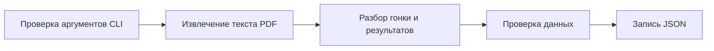

# PDF-парсер протокола соревнований

[← Вернуться в основной README](../README.md)

## Назначение

Скрипт [backend/scripts/parse_protocol.py](../backend/scripts/parse_protocol.py)
читает PDF-протокол, извлекает данные соревнования, проверяет их и сохраняет в JSON.
Это реализация задачи 2.1 из [плана бэкенда](backend-plan.md).

Парсер работает отдельно от приложения: ему не нужны запущенные API, PostgreSQL,
Docker или настройки `backend/.env`. Он не обращается к базе данных и не изменяет
исходный PDF. Импорт JSON в базу — отдельная задача 2.2.

Проверенный источник — [Total_result_Avacha-2026.pdf](Total_result_Avacha-2026.pdf).
Путь и имя входного файла могут быть любыми. Название гонки, год, даты,
количество участников и этапов извлекаются из документа. При этом правила разбора
ожидают структуру PDF образца 2026 года: это не универсальный парсер любых таблиц.
Excel и сканированные документы без текстового слоя пока не поддерживаются.

Этот документ описывает текущее поведение скрипта. Правила приложения и моделей
базы описаны отдельно в [docs/domain.md](domain.md) и [docs/database.md](database.md).

## Подготовка и запуск

Все примеры ниже выполняются из корня репозитория, в активированном виртуальном
окружении. Подготовка окружения описана в [backend/README.md](../backend/README.md).
Установить зависимости проекта:

```bash
python -m pip install -r backend/requirements.txt
```

Из внешних библиотек сам парсер использует только `pdfplumber`; остальные импорты
относятся к стандартной библиотеке Python.

### Сохранить JSON рядом с PDF

```bash
python backend/scripts/parse_protocol.py --pdf docs/Total_result_Avacha-2026.pdf
```

Результат будет записан в `docs/Total_result_Avacha-2026.json`.

### Указать другой выходной файл

```bash
python backend/scripts/parse_protocol.py --pdf docs/Total_result_Avacha-2026.pdf --output .cache/protocols/avacha-2026.json
```

### Файл вне репозитория

```bash
python backend/scripts/parse_protocol.py --pdf "/путь к протоколам/результаты.pdf"
```

В этом случае JSON появится рядом с указанным PDF: `результаты.json`.
Пути с пробелами нужно заключать в кавычки. Относительные пути считаются от
текущего рабочего каталога терминала, абсолютные — используются как указаны.

### Справка

```bash
python backend/scripts/parse_protocol.py --help
```

| Параметр | Поведение |
|---|---|
| `--pdf` | Обязательный путь к существующему входному файлу. Без него скрипт сообщает об ошибке и не начинает разбор; файл сам не ищет |
| `--output` | Необязательный путь к выходному файлу. По умолчанию расширение входного пути заменяется на `.json` |
| `--help`, `-h` | Показывает справку и завершает работу |

В `--output` нужно указать файл, а не существующий каталог. Пути входного и
выходного файлов должны отличаться после разрешения символических ссылок.
Недостающие родительские каталоги выходного файла создаются автоматически.
Существующий выходной файл перезаписывается.

После успешной записи скрипт печатает `JSON сохранён: <путь>`, затем предупреждения,
если они есть. Подробные строки участников в терминал не выводятся — они находятся
в JSON.

## Как устроена обработка



Код остаётся в одном файле и состоит из функций. Чтение PDF, разбор данных,
валидация и запись JSON имеют отдельные точки входа.

| Функция | За что отвечает |
|---|---|
| `parse_arguments` | Получает и проверяет пути из CLI |
| `keep_object` | Исключает символы водяного знака по цвету |
| `extract_pages` | Читает PDF и возвращает текст каждой страницы |
| `duration_to_seconds` | Проверяет длительность и переводит её в секунды |
| `parse_result` | Разбирает время или обозначение DNF/DNS/DSQ |
| `parse_race` | Извлекает название, год, даты и место проведения |
| `parse_protocol_metadata` | Извлекает погоду, главного судью и секретаря |
| `parse_stages` | Собирает номера и длины этапов из заголовков |
| `parse_participants` | Связывает участников с дисциплинами и собирает их результаты и штрафы |
| `parse_stage_results` | Разбирает пары «результат — скорость» для каждого этапа |
| `parse_summary` | Разбирает общий результат, место и примечание |
| `parse_penalties` | Извлекает штраф из примечания |
| `validate_time` | Проверяет согласованность статуса и времени |
| `validate_protocol` | Проверяет участников, этапы и итоговое время |
| `parse_protocol` | Собирает весь документ, предупреждения и вызывает валидацию |
| `save_protocol_json` | Записывает словарь в JSON |
| `main` | Последовательно запускает CLI, разбор и сохранение, выводит предупреждения |

### Извлечение текста

`extract_pages` открывает PDF через `pdfplumber` и обрабатывает все страницы.
Перед извлечением текста `keep_object` удаляет символы с RGB-цветом
`(0.9098039, 0.9098039, 0.9098039)`, допуск для каждой компоненты — `0.0001`.
Так отфильтровывается серый водяной знак исходного протокола.

Текст извлекается с `x_tolerance=1` и `y_tolerance=1`. Если хотя бы на одной странице
нет непустого текста, разбор завершается ошибкой.

Читаются текстовые объекты PDF, включая белые символы. Поэтому визуально пустая
ячейка исходного протокола может содержать `00:00:00` или служебную ошибку Excel.
Такие значения не заменяются догадками о результате участника.

### Шапка, дисциплины и строки участников

Название ищется в кавычках `«…»` в шапке первой страницы, даты — в формате
`06 - 15 февраля 2026 г.`. Месяц должен быть записан по-русски; обе даты должны
находиться в одном месяце и году. Место проведения берётся из следующей непустой
строки после дат.

Этапы ищутся по заголовкам вида `Этап 1 длина 33,7 км` и сортируются по номеру.
Повторяющиеся заголовки допустимы, если длина того же этапа не меняется.

Поддерживаемые названия дисциплин заданы в `DISCIPLINE_CODES`:

| Название в PDF | Код в JSON |
|---|---|
| Лыжи длинная дистанция 2 собаки | `ski_2` |
| Нарта-длинная дистанция 8 собак | `sled_8` |
| Нарта-длинная дистанция более 8 собак | `sled_8plus` |

Каждый участник относится к последнему прочитанному заголовку дисциплины.
Строка участника должна содержать порядковый номер, стартовый номер, ФИО,
четырёхзначный год рождения, регион, результаты и общий итог.
Регион отделяется по первому времени или обозначению DNF/DNS/DSQ.

Далее ожидаются пары «результат — скорость» для этапов в порядке возрастания номера.
После них идут средняя скорость, общий результат, место и примечание.
Скорости проверяются на ожидаемый формат, но не сохраняются в JSON. Разрешены
числа с точкой или запятой и служебные значения `#ЗНАЧ!`, `#ДЕЛ/0!`.

## Структура JSON

Файл записывается в UTF-8, с отступом в два пробела и читаемой кириллицей.
Значение Python `None` записывается как JSON `null`.

### Поля документа

| Поле | Содержимое |
|---|---|
| `source_filename` | Имя исходного файла без пути |
| `race` | Название, год, даты и место проведения гонки |
| `protocol_metadata` | Погода и подписи судей |
| `stages` | Список этапов |
| `participants` | Список участников со всеми результатами и штрафами |
| `warnings` | Общий список предупреждений с указанием участника и этапа, когда они известны |

### Гонка, метаданные и этапы

| Объект | Поля |
|---|---|
| `race` | `name` — название с годом; `year` — год числом; `start_date`, `end_date` — строки `YYYY-MM-DD`; `location` — место; `raw_name`, `raw_dates` — исходные название и строка дат |
| `protocol_metadata` | `weather`, `chief_judge`, `chief_secretary` — строки или `null`, если поле не найдено |
| Элемент `stages` | `number` — номер; `distance_km` — длина в километрах |

### Участник

| Поле | Содержимое |
|---|---|
| `start_number` | Стартовый номер числом |
| `full_name` | ФИО одной строкой |
| `birth_year` | Год рождения числом |
| `region` | Регион из протокола |
| `discipline_code`, `discipline_name` | Код и исходное название дисциплины |
| `results_text` | Извлечённый текст результатов участника |
| `stage_results` | Список результатов всех этапов |
| `summary_text` | Текст общего итога после отделения результатов этапов |
| `summary` | Разобранный общий итог |
| `penalties` | Список распознанных штрафов участника за гонку; без штрафов — пустой список |
| `penalty_warnings` | Предупреждения при разборе примечания и штрафа |

### Результат этапа и общий итог

| Объект | Поля |
|---|---|
| Элемент `stage_results` | `stage_number` — номер этапа; `raw_result` — исходное время или обозначение; `status` — статус или `null`; `final_time_seconds` — время в секундах или `null`; `warning` — предупреждение или `null` |
| `summary` | `raw_result` — исходный общий результат; `status` — общий статус; `total_time_seconds` — общее время в секундах или `null`; `total_penalty_seconds` — сумма распознанных штрафов за гонку в секундах; `source_place` — место из источника или `null`; `raw_note` — исходное примечание |

Место сохраняется как указано в источнике. Парсер не пересчитывает места и не
объединяет зачёты разных дисциплин.

### Штраф участника за гонку

Штрафы находятся в `participants[].penalties`. В модели БД штраф относится к участию
в гонке через `Penalty.race_participant_id` → `RaceParticipant.id`.

| Поле | Содержимое |
|---|---|
| `seconds` | Длительность штрафа в секундах |
| `rule_reference` | Пункт правил, например `П.14.11.14` |
| `stage_number` | Всегда `null` в текущем JSON; это поле не задаёт связь с этапом в модели БД |
| `raw_note` | Текст примечания, из которого получен штраф |

Исходные текстовые поля нужны для сверки результата с PDF. Это значения после
извлечения текста, а не точная копия исходного файла: при разборе пробелы могут
нормализоваться.

## Время, статусы и штрафы

Длительность должна иметь формат `ЧЧ:ММ:СС`: часы — не меньше двух цифр,
минуты и секунды — от `00` до `59`. Часы могут превышать 23, поскольку это
длительность, а не время суток. Например, `29:07:47` превращается в `104867` секунд.

| Значение в PDF | Статус | Время в JSON |
|---|---|---|
| Положительная длительность | `finished` | Целое число секунд |
| `DNF` | `dnf` | `null` |
| `DNS` | `dns` | `null` |
| `DSQ` | `dsq` | `null` |
| `00:00:00` на этапе | `null` | `null`, с предупреждением |
| Нулевой общий результат | Не сохраняется | Критическая ошибка |

Обозначения DNF/DNS/DSQ ожидаются в верхнем регистре, как в исходном PDF.
Нулевые этапы не превращаются автоматически в DNS или DNF по предыдущим этапам.
Общий статус также берётся из источника: DNS после завершённых этапов не заменяется
на DNF.

Пример результата второго этапа участницы №1:

```json
{
  "stage_number": 2,
  "raw_result": "00:00:00",
  "status": null,
  "final_time_seconds": null,
  "warning": "Нулевое значение: статус этапа требует проверки"
}
```

Отображение `null` как «—» относится к интерфейсу приложения; в JSON хранится `null`.

Штраф распознаётся из одного примечания вида `штр.вр. 2 мин. п.П.14.11.14`.
Поддерживаются целые минуты (`мин.`) и секунды (`сек.`), различия регистра,
пробелов и запятая вместо точки после первого `п`.
Пустое примечание и `0` означают отсутствие распознанного штрафа.

Пример штрафа участника №18:

```json
{
  "seconds": 120,
  "rule_reference": "П.14.11.14",
  "stage_number": null,
  "raw_note": "штр.вр. 2 мин. п.П.14.11.14"
}
```

Штраф сохраняется за участником на всю гонку с `stage_number: null`.
Отсутствие номера этапа не вызывает предупреждения.
Нераспознанное примечание сохраняется в
`summary.raw_note`, список `penalties` остаётся пустым и добавляется предупреждение.
Несколько штрафов в одном примечании текущий шаблон не разбирает.

**Время в исходном протоколе уже включает штрафы.** Парсер сохраняет время этапов
и общий итог как в источнике, не прибавляет штраф повторно и не вычисляет чистое
время. В `summary.total_penalty_seconds` сохраняется справочная сумма `seconds`
из `penalties` участника. Поле есть при любом общем статусе, включая DNF/DNS/DSQ;
если распознанных штрафов нет, значение равно `0`. Эта сумма не прибавляется
к `summary.total_time_seconds` и не меняет время этапов.

## Проверки, ошибки и предупреждения

Перед сохранением проверяется:

- наличие хотя бы одного этапа и участника;
- уникальность номеров этапов и стартовых номеров участников в документе;
- совпадение набора результатов каждого участника с набором этапов, включая отсутствие повторов;
- положительное целое время для `finished` и отсутствие времени для остальных статусов;
- завершение всех этапов при общем статусе `finished`;
- равенство общего времени финишировавшего участника сумме времён его этапов.

При разборе также проверяются формат времени и строки участника, известность
дисциплины, положительная длина этапов, корректность дат и наличие места у
финишировавшего участника. Противоречащие друг другу повторные длины этапов или
значения погоды и подписей судей вызывают ошибку.

Критические ошибки прекращают обработку. Ошибки аргументов выводятся через
`argparse` с подсказкой по запуску. Ошибки разбора вызывают `ValueError`; ошибки
чтения и записи файлов также не скрываются. Сейчас такие ошибки могут выводиться
с traceback.

Предупреждения позволяют сохранить JSON, но требуют сверки данных:

| Ситуация | Результат |
|---|---|
| Нулевое время этапа | Неизвестный статус и время, исходное значение сохраняется |
| Нет погоды, судьи или секретаря | Соответствующее поле равно `null` |
| Примечание не распознано или длительность штрафа некорректна | Исходное примечание сохраняется, штраф не создаётся |

Предупреждения результатов и штрафов собираются в общий `warnings` с контекстом
участника. Предупреждение также остаётся в самом результате или в
`penalty_warnings` участника. Отсутствие предупреждений не доказывает корректность
произвольного PDF: проверки рассчитаны на поддерживаемую структуру документа.

Разбор и валидация выполняются до записи. При ошибке на этих шагах новый JSON
не создаётся, существующий выходной файл не меняется. Сама запись выполняется
напрямую, без временного файла и атомарной замены.

## Проверенный результат для «Авача — 2026»

| Данные | Количество |
|---|---|
| Дисциплины | 3 |
| Этапы | 6 |
| Участники | 21 |
| Результаты этапов | 126 |
| Распознанные штрафы | 3 |
| Предупреждения | 8 |

Из 126 результатов этапов: 116 — `finished`, один — `dnf`, один — `dns`,
восемь — с неизвестным статусом и временем. Общие результаты: 19 — `finished`,
один — `dnf`, один — `dns`.

Все восемь предупреждений относятся к нулевым этапам участниц №1 и №10.
Штрафы участников №18, №19 и №12 составляют соответственно 120, 3 и 360 секунд;
эти суммы сохранены в `summary.total_penalty_seconds` каждого участника.
Общее время каждого из 19 финишировавших совпадает с суммой его этапов.

Эти числа — ориентир для проверки исходного файла, а не ограничения программы.

## Ограничения и сопровождение

- PDF должен иметь текстовый слой. OCR и чтение Excel не реализованы.
- Парсер зависит от порядка колонок и ожидает всю строку участника на одной строке извлечённого текста.
- Названия дисциплин должны совпадать с `DISCIPLINE_CODES`. Новые названия требуют изменения словаря.
- Формат дат, заголовков и примечаний ограничен описанными выше шаблонами.
- Фильтр водяного знака привязан к цвету символов исходного протокола.
- Парсер не вычисляет чистое время. Штрафы сохраняются за гонку в списке участника;
  импорт в БД — отдельная задача 2.2.

Перед применением к новому протоколу нужно сверить извлечённые данные с PDF,
проверить предупреждения и общий итог. При изменении структуры источника следует
адаптировать соответствующую функцию разбора и обновить это описание.

[← Вернуться в основной README](../README.md)
